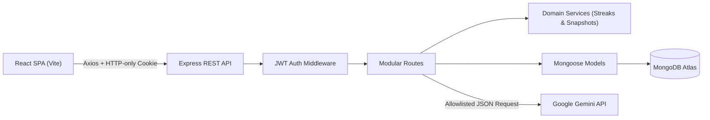
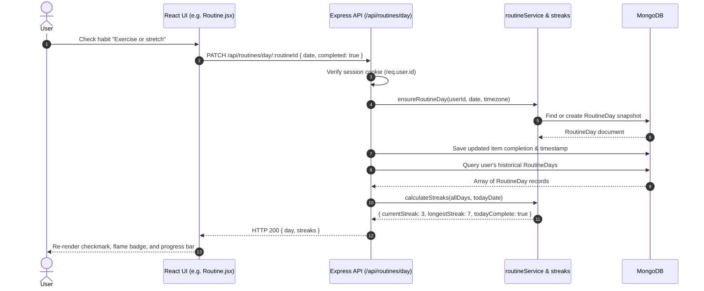
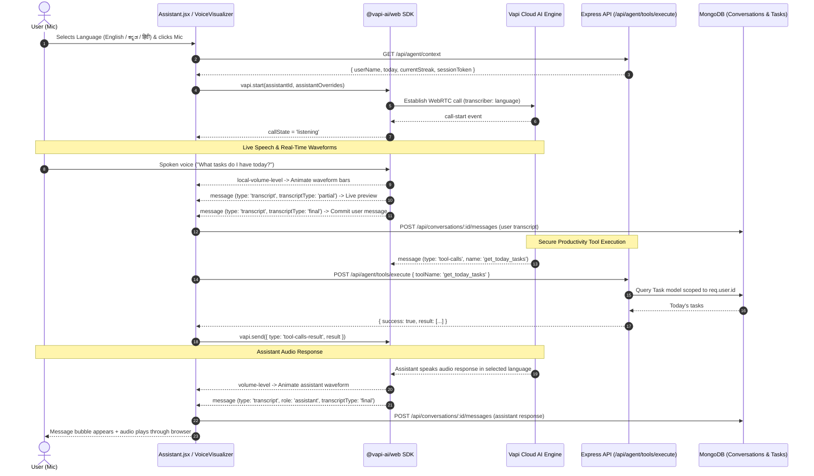

# TaskPilot AI

> **A full-stack personal productivity workspace combining task management, daily routine checklists, date-snapshotted habit streaks, and an interactive multilingual voice assistant powered by Vapi Voice AI.**  
> Built as an Adobe apprenticeship capstone in clean, readable, modular JavaScript.

[](#run-tests)
[](#build-for-production)
[](#license)

---

## Table of Contents
1. [Project Overview & Key Features](#1-project-overview--key-features)
2. [Actual Technology Stack](#2-actual-technology-stack)
3. [Folder Structure & Key Files](#3-folder-structure--key-files)
4. [Architecture & System Design](#4-architecture--system-design)
5. [Application Data Flow](#5-application-data-flow)
6. [Database Models & Purpose](#6-database-models--purpose)
7. [API Endpoint Documentation](#7-api-endpoint-documentation)
8. [Authentication & Authorization Flow](#8-authentication--authorization-flow)
9. [Multilingual Vapi Voice AI Integration Flow](#9-multilingual-vapi-voice-ai-integration-flow)
10. [Routine Checklist & Streak Calculation Rules](#10-routine-checklist--streak-calculation-rules)
11. [Prerequisites & Installation](#11-prerequisites--installation)
12. [Environment Variables](#12-environment-variables)
13. [Run Commands & Tests](#13-run-commands--tests)
14. [Build & Deployment Instructions](#14-build--deployment-instructions)
15. [Known Limitations & Troubleshooting](#15-known-limitations--troubleshooting)
16. [Technical Assessment Demo Walkthrough](#16-technical-assessment-demo-walkthrough)

---

## 1. Project Overview & Key Features

TaskPilot AI is designed to solve a fundamental flaw in conventional productivity apps: **the conflation of ad-hoc tasks with steady daily habits.**

In standard to-do applications, checking off 10 tasks on Monday and 0 tasks on Tuesday creates artificial volatility. TaskPilot cleanly decouples tasks from routines:
- **Tasks** track work to be done (projects, errands, deadlines).
- **Routines** track daily habits (exercise, reading, reflection) and form the foundation of the user's **routine streaks**.
- **Historical Snapshots** preserve past days' checklists even when routine templates are modified or deleted in the future.
- **Multilingual Voice AI (Vapi Web SDK):** Natural voice conversations with real-time speech visualizers, dynamic volume waveforms, and language switching across English, Kannada (ಕನ್ನಡ), and Hindi (हिंदी).
- **Persistent Conversation History:** All voice and chat transcripts are stored in MongoDB and associated with the user's account for multi-turn continuity.
- **Secure Productivity Voice Tools:** Voice AI can check today's schedule, retrieve upcoming/overdue tasks, create/reschedule/complete tasks, and report routine streaks using real backend database data.

### Core Features:
- 🔐 **Authentication & Security:** Email signup, password hashing with bcrypt, signed HTTP-only JWT cookies, rate limiting, and private account isolation.
- 🎙️ **Vapi Voice AI:** Native WebRTC audio calls with real-time call states (`idle`, `connecting`, `listening`, `user-speaking`, `thinking`, `assistant-speaking`, `ended`), live volume-driven waveforms, and live interim speech previews.
- 🌐 **Multilingual Interaction:** Seamless language selection across English (`en`), Kannada (`kn`), and Hindi (`hi`), updating transcriber hints, voice prompts, and quick suggestions.
- 💾 **MongoDB Conversation Persistence:** Incremental message saving, session history switching, auto-generated conversation titles, and conversation deletion.
- 📋 **Task Management:** Full CRUD, priority tagging (`urgent`, `high`, `medium`, `low`), status workflows (`todo`, `in_progress`, `completed`), deadline tracking, real-time search, and automatic `completedAt` timestamp tracking.
- 📅 **Interactive Calendar:** 42-cell Monday-first monthly matrix displaying task deadlines color-coded by priority, with direct date click-to-add support.
- 🔁 **Date-Snapshotted Routines:** Daily checklist populated automatically based on active habit templates and scheduled weekdays. Supports required vs. optional items.
- 🔥 **Streak Engine:** Calculates current streak and all-time longest streak strictly from routine completions. Accounts for pending today without breaking streaks.
- 📊 **Productivity Insights:** Visual analytics displaying 7-day task creation vs. completion activity and priority distribution.
- 🎨 **Responsive UI & Themes:** Sleek light/dark mode, collapsible mobile navigation, loading skeletons, and empty states.

---

## 2. Actual Technology Stack

### Frontend (Client)
- **Framework & Build:** React 18 (`^18.3.1`) + Vite 6 (`^6.0.7`)
- **Voice AI SDK:** `@vapi-ai/web` (`^2.5.2`) for WebRTC voice streaming, volume metering, and audio player integration
- **Routing:** React Router DOM v7 (`^7.1.1`)
- **HTTP Client:** Axios (`^1.7.9`) with `withCredentials: true`
- **Icons:** Lucide React (`^0.468.0`)
- **Styling:** Custom Vanilla CSS with modern tokens, responsive breakpoints, CSS Grid/Flexbox, and dynamic `[data-theme='dark']` styling.

### Backend (Server)
- **Runtime:** Node.js 20+ (Native ES Modules `"type": "module"`)
- **Web Framework:** Express 4 (`^4.21.2`)
- **Security:** Helmet 8 (`^8.0.0`), CORS 2 (`^2.8.5`), Express Rate Limit (`^7.5.0`), Cookie Parser (`^1.4.7`)
- **Authentication:** JSON Web Tokens (`jsonwebtoken ^9.0.2`), bcrypt password hashing (`bcryptjs ^2.4.3`)
- **Database ODM:** Mongoose 8 (`^8.9.5`)
- **External AI:** Google Generative AI REST API (Gemini models) via native `fetch` with `AbortSignal.timeout`
- **Testing:** Node.js native test runner (`node --test`) and assertion library (`node:assert/strict`)

---

## 3. Folder Structure & Key Files

The project follows a clean, modular structure that separates concerns:

```
files-pasted-by-the-user-master/
├── package.json               # Root scripts (dev, build, test, server, client)
├── package-lock.json
├── README.md                  # Comprehensive project documentation
├── docs/
│   ├── ARCHITECTURE.md        # Deep architectural design, security & schemas
│   └── CODE_GUIDE.md           # Interview questions & code walkthrough handbook
├── client/                    # React frontend application
│   ├── index.html             # Vite entry HTML
│   ├── vite.config.js         # Vite configuration with React plugin
│   ├── package.json           # Client scripts & dependencies
│   ├── .env.example           # Client environment variable template
│   └── src/
│       ├── main.jsx           # Mounts React DOM root
│       ├── App.jsx            # Session verification & theme state
│       ├── style.css          # Design system & dark mode CSS
│       ├── api/
│       │   └── client.js      # Configured Axios instance
│       ├── hooks/
│       │   └── useLoad.js     # Custom data-fetching hook
│       ├── utils/
│       │   └── dateUtils.js   # Date arithmetic helpers
│       ├── components/
│       │   ├── common/        # Reusable UI (Heading, Stat, Notice, Skeleton, Empty, QuickAdd)
│       │   ├── tasks/         # TaskRow.jsx, TaskModal.jsx
│       │   └── layout/        # Shell.jsx (Sidebar, Topbar, Modal wrapper)
│       └── pages/             # Auth, Overview, Tasks, Routine, Calendar, Assistant, Insights, Settings
└── server/                    # Node.js Express REST API backend
    ├── package.json           # Server scripts & dependencies
    ├── .env.example           # Server environment variable template
    ├── app.js                 # Express server bootstrap & route mounting
    ├── middleware/
    │   ├── auth.js            # JWT cookie verification middleware
    │   ├── errorHandler.js    # Centralized error handler
    │   └── asyncHandler.js    # Async route wrapper
    ├── models/
    │   ├── User.js            # User credentials & timezone model
    │   ├── Task.js            # Task schema with compound indexes
    │   ├── Routine.js         # Habit templates schema
    │   ├── RoutineDay.js      # Date-specific checklist snapshot schema
    │   ├── index.js           # Models aggregator
    │   └── models.js          # Backwards-compatible models re-export
    ├── services/
    │   ├── streaks.js         # Core streak calculation algorithm
    │   └── routineService.js  # Date formatting & snapshot creation logic
    ├── routes/
    │   ├── authRoutes.js      # /api/auth (signup, login, logout, me)
    │   ├── userRoutes.js      # /api/users/me (profile & timezone update)
    │   ├── taskRoutes.js      # /api/tasks (CRUD & search)
    │   ├── routineRoutes.js   # /api/routines (templates & daily checklist)
    │   ├── analyticsRoutes.js # /api/analytics (summary & task charts)
    │   └── agentRoutes.js     # /api/agent/command (Gemini AI integration)
    └── tests/
        └── streaks.test.js    # Unit test suite for streak business logic
```

---

## 4. Architecture & System Design



1. **Client Layer:** React manages UI state. Data loading uses the `useLoad` hook. User actions trigger Axios requests with `withCredentials: true`.
2. **Security & Session Layer:** Requests pass through Helmet security headers, CORS origin verification, and the `authenticateToken` middleware, which verifies the JWT stored in the HTTP-only cookie.
3. **Domain Layer:** Business rules (streak calculations and routine snapshotting) are isolated inside `server/services/`, keeping routes lean.
4. **Data Layer:** Mongoose enforces schema validation and manages compound indexes in MongoDB Atlas.

---

## 5. Application Data Flow



---

## 6. Database Models & Purpose

### 1. `User` (`server/models/User.js`)
Stores authenticated user credentials and personal settings:
- `name` (String, required): Display name.
- `email` (String, required, unique, lowercase): Account identifier.
- `passwordHash` (String, required): bcrypt hashed password (salt cost 12).
- `timezone` (String, default 'UTC'): Crucial for local calendar date resolution (`YYYY-MM-DD`).
- `preferences` (Object): `{ theme: 'light', cutoffHour: 23 }`.

### 2. `Task` (`server/models/Task.js`)
Stores individual task items:
- `userId` (ObjectId, ref User, required, indexed): Tenant owner.
- `title` (String, max 160, required): Task description.
- `description` (String, default ''): Optional details.
- `priority` (Enum: `'urgent'`, `'high'`, `'medium'`, `'low'`, default `'medium'`).
- `status` (Enum: `'todo'`, `'in_progress'`, `'completed'`, default `'todo'`).
- `dueDate` (Date, default null): Deadline.
- `estimatedMinutes` (Number, 1-1440): Time estimate.
- `completedAt` (Date, default null): Timestamp when marked completed.
- `source` (Enum: `'manual'`, `'ai'`, `'voice'`, default `'manual'`).
- **Compound Index:** `{ userId: 1, dueDate: 1, status: 1 }` for high-performance calendar and deadline queries.

### 3. `Routine` (`server/models/Routine.js`)
Defines recurring habit blueprints:
- `userId` (ObjectId, ref User, indexed): Owner.
- `title` (String, required): Habit label.
- `isRequired` (Boolean, default true): Determines if habit affects streak calculations.
- `isActive` (Boolean, default true): Inactive templates are not snapshotted into future dates.
- `scheduledDays` (Array of Numbers 0..6): Days of week this habit runs.
- `sortOrder` (Number, default 0).

### 4. `RoutineDay` (`server/models/RoutineDay.js`)
Represents an immutable, date-specific snapshot of routine checklist items:
- `userId` (ObjectId, ref User, required).
- `localDate` (String, required, 'YYYY-MM-DD'): User's localized calendar date.
- `timezone` (String, required).
- `items` (Array): `[{ routineId, title, isRequired, completed, completedAt }]`.
- `eligible` (Boolean): True if at least one required routine was scheduled.
- `finalized` (Boolean).
- **Compound Unique Index:** `{ userId: 1, localDate: 1 }` guarantees one checklist per user per calendar day.

### 5. `Conversation` (`server/models/Conversation.js`)
Stores persistent voice and text conversation histories in MongoDB:
- `userId` (ObjectId, ref User, required, indexed): Owner.
- `title` (String, default 'New Conversation'): Auto-generated or custom conversation title.
- `mode` (Enum: `'text'`, `'voice'`, `'mixed'`, default `'mixed'`).
- `language` (Enum: `'en'`, `'kn'`, `'hi'`, `'auto'`, default `'en'`).
- `messages` (Array of subdocuments):
  - `id`: Unique message ID (deduplication key).
  - `role`: `'user'` | `'assistant'` | `'system'` | `'tool'`.
  - `content`: Message text or finalized voice transcript.
  - `mode`: `'voice'` | `'text'`.
  - `language`: Spoken or response language.
  - `timestamp`: Creation time.
- `lastActivityAt` (Date, indexed): For sorting recent conversations.
- **Compound Index:** `{ userId: 1, lastActivityAt: -1 }` for fast retrieval of the user's conversation list.

---

## 7. API Endpoint Documentation

All endpoints (except signup, login, health, and verified webhooks) require the `taskpilot` HTTP-only cookie.

| Method | Endpoint | Description | Auth Required |
| :--- | :--- | :--- | :--- |
| `GET` | `/api/health` | Health check endpoint | No |
| `POST` | `/api/auth/signup` | Register new account & set JWT cookie | No (Rate Limited) |
| `POST` | `/api/auth/login` | Sign in & set JWT cookie | No (Rate Limited) |
| `POST` | `/api/auth/logout` | Clear session cookie | Yes |
| `GET` | `/api/auth/me` | Fetch authenticated user profile | Yes |
| `PATCH`| `/api/users/me` | Update display name and timezone | Yes |
| `GET` | `/api/tasks` | List tasks (supports `status`, `priority`, `date`, `search` query params) | Yes |
| `POST` | `/api/tasks` | Create a new task | Yes |
| `PATCH`| `/api/tasks/:id` | Update task details or toggle completion status | Yes |
| `DELETE`| `/api/tasks/:id` | Delete a task | Yes |
| `GET` | `/api/routines` | List habit templates | Yes |
| `POST` | `/api/routines` | Create habit template | Yes |
| `PATCH`| `/api/routines/:id` | Update habit template (title, isRequired, isActive) | Yes |
| `DELETE`| `/api/routines/:id` | Delete habit template | Yes |
| `GET` | `/api/routines/day` | Get checklist snapshot & streaks for a date (`?date=YYYY-MM-DD`) | Yes |
| `GET` | `/api/routines/history`| Get last 180 checklist records | Yes |
| `PATCH`| `/api/routines/day/:routineId` | Toggle checklist item completion on a date snapshot | Yes |
| `GET` | `/api/analytics/summary` | Dashboard summary metrics (counts, streaks, recent tasks) | Yes |
| `GET` | `/api/analytics/tasks` | 7-day activity trends and priority distribution | Yes |
| `GET` | `/api/conversations` | List saved conversations with summaries & last message | Yes |
| `POST` | `/api/conversations` | Create a new persistent conversation session | Yes |
| `GET` | `/api/conversations/:id` | Retrieve conversation and full message history | Yes |
| `POST` | `/api/conversations/:id/messages` | Append finalized messages (deduplicated) | Yes |
| `PATCH`| `/api/conversations/:id` | Update conversation title or language | Yes |
| `DELETE`| `/api/conversations/:id` | Delete conversation and its messages | Yes |
| `GET` | `/api/agent/context` | Get personalized context & transient Vapi session token | Yes |
| `POST` | `/api/agent/tools/execute` | Execute productivity tool from client Vapi SDK | Yes |
| `POST` | `/api/agent/vapi-webhook` | Server-to-server webhook for Vapi tool-calls | Token Verified |
| `POST` | `/api/agent/command` | Natural language text AI processing (Gemini fallback) | Yes |

---

## 8. Authentication & Authorization Flow

TaskPilot uses **HTTP-only, SameSite=Lax signed cookies** for session management:

1. **Signup/Login:** User submits credentials to `/api/auth/login` or `/api/auth/signup`.
2. **Password Verification:** Passwords are verified using `bcrypt.compare`.
3. **Token Issuance:** On success, Express signs a JWT with `{ id: user._id }` using `JWT_SECRET` and attaches it via `res.cookie('taskpilot', token, tokenCookieOptions)`:
   - `httpOnly: true`: JavaScript cannot access `document.cookie` (blocks XSS exfiltration).
   - `sameSite: 'lax'`: Mitigates CSRF vulnerabilities.
   - `secure: true`: Enforced in production environments.
   - `maxAge: 7 * 24 * 60 * 60 * 1000` (7 days).
4. **Subsequent Requests:** Browser automatically transmits the cookie. The `authenticateToken` middleware verifies the token and attaches `req.user = decoded`.
5. **Tenant Scoping:** All database queries are explicitly filtered by `userId: req.user.id`.

---

## 9. Multilingual Vapi Voice AI Integration Flow

TaskPilot integrates the official **Vapi Web SDK (`@vapi-ai/web`)** directly into the AI Assistant section, enabling real-time WebRTC audio conversations with live audio waveforms, transcription streaming, and backend tool execution.



### Live Visual Call States:
1. **Idle:** Microphone ready; click to start.
2. **Connecting:** Establishing WebRTC media connection.
3. **Listening:** Microphone active; assistant waiting for user speech.
4. **User Speaking:** Audio activity waveform bounces in real time; live transcript bubble shows words as spoken.
5. **Thinking:** User speech finished; assistant processing or executing backend tools.
6. **Assistant Speaking:** Assistant audio response playing through audio player; green waveform bounces with audio amplitude.
7. **Error:** Clear recovery message displayed; microphone permission instructions.
8. **Ended:** Graceful session termination and return to idle.

### Multilingual Support:
- **English (`en`):** Deepgram Nova-2 English transcriber with natural conversation prompts.
- **Kannada (`kn`):** Deepgram multilingual transcriber with Kannada prompts (e.g. *“ಇವತ್ತು ನಾನು ಯಾವ ಕೆಲಸಗಳನ್ನು ಮುಗಿಸಬೇಕು?”*).
- **Hindi (`hi`):** Deepgram Hindi transcriber with Hindi prompts (e.g. *“आज मुझे कौन-कौन से काम पूरे करने हैं?”*).

### Secure Tool Architecture:
Voice tools (`get_today_tasks`, `get_upcoming_tasks`, `get_overdue_tasks`, `create_task`, `update_task`, `complete_task`, `get_routine_status`, `get_productivity_summary`) are executed strictly against the authenticated user (`req.user.id`). The AI never possesses direct database access.

---

## 10. Routine Checklist & Streak Calculation Rules

TaskPilot's streak engine (`server/services/streaks.js`) operates on strict, predictable mathematical rules verified by automated tests:

1. **Routines Only:** Ad-hoc task completion never influences routine streaks.
2. **Qualifying Day (Success):** A date is successful if:
   - The snapshot is marked `eligible: true`.
   - The snapshot contains at least one required routine item (`isRequired: true`).
   - **All** required items for that date are marked completed.
3. **Optional Items:** Items with `isRequired: false` do not count toward or against streaks.
4. **Pending Today Rule:** If today's routine checklist is not yet completed, it does **not** break yesterday's streak. Today is considered in progress.
5. **Midday UTC Date Stepping:** Date transitions step backward using midday UTC (`12:00:00Z`). This guarantees that Daylight Saving Time transitions (23-hour or 25-hour days) never shift calendar dates unexpectedly.

---

## 11. Prerequisites & Installation

### Prerequisites
- **Node.js:** v20.0.0 or higher
- **npm:** v10.0.0 or higher
- **MongoDB:** MongoDB Atlas cluster URI or local MongoDB instance (`mongodb://localhost:27017/taskpilot`)

### Installation Steps

1. Clone or navigate to the repository root:
   ```sh
   cd d:/2026-10-24/files-pasted-by-the-user-master
   ```

2. Install root and sub-project dependencies:
   ```sh
   npm install
   npm --prefix server install
   npm --prefix client install
   ```

---

## 12. Environment Variables

### Server Configuration (`server/.env`)
Copy `server/.env.example` to `server/.env`:
```sh
cp server/.env.example server/.env
```

Set the following variables (placeholders shown):
```ini
# MongoDB Connection String
MONGODB_URI=mongodb+srv://<username>:<password>@<cluster-host>/<database>?retryWrites=true&w=majority

# JWT Signing Secret (use a 64+ character random string)
JWT_SECRET=your-super-secret-jwt-signing-key-here-min-32-chars

# Client Origin for CORS
CLIENT_ORIGIN=http://localhost:5173

# API Server Port
PORT=4000

# Optional Google Gemini AI Configuration
GEMINI_API_KEY=your-gemini-api-key-here
GEMINI_MODEL=gemini-3.5-flash-lite

# Environment Mode
NODE_ENV=development
```

### Client Configuration (`client/.env`)
Copy `client/.env.example` to `client/.env`:
```sh
cp client/.env.example client/.env
```

```ini
# Base URL for Express REST API
VITE_API_URL=http://localhost:4000/api
```

---

## 13. Run Commands & Tests

### Development Mode (Runs Frontend + Backend Concurrently)
```sh
npm run dev
```
- Client runs at: `http://localhost:5173`
- Server API listens at: `http://localhost:4000`

### Run Backend Only
```sh
npm run server
```

### Run Frontend Only
```sh
npm run client
```

### Run Tests
Execute the unit test suite verifying streak business logic:
```sh
npm test
```

Expected output:
```
✔ counts consecutive successful routine dates and longest streak
✔ pending today does not break yesterday streak
✔ missed date breaks the current streak and task data is irrelevant
✔ optional unfinished items do not block success
✔ zero required items cannot earn a streak
✔ streak continues across month and year boundary
✔ unchecking the only successful day removes current streak
ℹ tests 7
ℹ pass 7
ℹ fail 0
```

### Build for Production
```sh
npm run build
```
Builds the Vite React client into `client/dist`.

---

## 14. Build & Deployment Instructions

### Frontend (e.g. Vercel / Netlify / Cloudflare Pages)
1. Set Root Directory to `client`.
2. Build Command: `npm run build`
3. Output Directory: `dist`
4. Set Environment Variable: `VITE_API_URL=https://api.yourdomain.com/api`

### Backend (e.g. Render / Railway / AWS App Runner)
1. Set Root Directory to `server`.
2. Build Command: `npm install`
3. Start Command: `npm start` (runs `node app.js`)
4. Configure Environment Variables:
   - `MONGODB_URI`
   - `JWT_SECRET`
   - `CLIENT_ORIGIN=https://app.yourdomain.com`
   - `NODE_ENV=production`
   - `GEMINI_API_KEY` (optional)

---

## 15. Known Limitations & Troubleshooting

### Known Limitations
1. **MongoDB Connection Required:** Persistent accounts and data require an active MongoDB Atlas or local connection.
2. **AI Action Scope:** The assistant deliberately supports only `create_task`, `list_tasks`, and `plan_day`. Destructive actions (deletion) must be performed manually by the user.
3. **Voice Recognition Browser Support:** Uses browser `SpeechRecognition` / `webkitSpeechRecognition`, which is supported in Chrome, Edge, and Safari, and requires HTTPS outside localhost.
4. **SameSite Cookies:** Local development uses `sameSite: 'lax'`. For production deployments hosted on differing top-level domains, configure `sameSite: 'none'` with `secure: true`.

### Troubleshooting

- **MongoDB connection failed on start:**
  - Verify IP access list in MongoDB Atlas (allow current IP or `0.0.0.0/0` for testing).
  - Verify `MONGODB_URI` format in `server/.env`.
  - Node uses IPv4-first resolution (`dns.setDefaultResultOrder('ipv4first')`) to bypass local IPv6 DNS hanging.
- **Client displays "Could not connect to TaskPilot. Is the API running?":**
  - Verify that the server is running on port 4000.
  - Check browser DevTools network tab to ensure `VITE_API_URL` is pointing to the correct API base URL.
- **AI returns "AI assistant is not configured":**
  - Add a valid `GEMINI_API_KEY` in `server/.env` and restart the backend.

---

## 16. Technical Assessment Demo Walkthrough

Use this structured 10-minute demo to present the project during a technical assessment:

1. **Architecture & Security:**
   - Sign up with a new user account.
   - Open DevTools Application tab -> Cookies -> highlight the `taskpilot` cookie with `HttpOnly` and `SameSite=Lax`.
   - Explain why this mitigates XSS token theft compared to `localStorage`.
2. **Task Management & Compound Indexing:**
   - Create a task with priority `urgent` and assign a deadline.
   - Demonstrate real-time search and status filtering (`todo` -> `completed`).
   - Mention the compound index `{ userId: 1, dueDate: 1, status: 1 }` in MongoDB.
3. **Interactive Calendar:**
   - Navigate to the Calendar view.
   - Show how the 42-cell matrix maps deadlines to specific days. Click a day to quick-add a task for that date.
4. **Daily Routine Snapshots & Streaks:**
   - Open `/routine`. Explain the Date Snapshot Pattern: editing templates today never rewrites historical completions.
   - Check off today's required habits and observe the flame badge streak increment in real time.
   - Explain the "Pending Today" rule: uncompleted habits for today do not break yesterday's streak.
5. **AI Assistant & Voice Input:**
   - Navigate to `/assistant`.
   - Use voice or prompt: *"Create a high priority task to review system architecture"*.
   - Show the assistant returning validated structured actions without arbitrary database access.
6. **Codebase & Automated Tests:**
   - Run `npm test` in the terminal to demonstrate all 7 streak tests passing.
   - Open `server/services/streaks.js` and walk through the midday UTC date logic.
