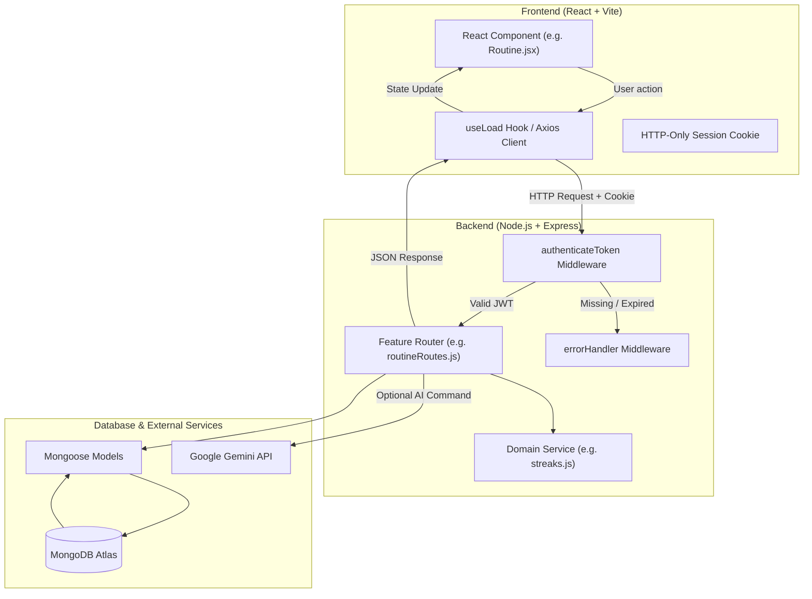

# TaskPilot AI — Code Guide & Interview Prep Handbook

> **Prepared for Adobe Apprenticeship Technical Assessment**  
> This guide is structured around the 6 core questions interviewers ask about production-grade full-stack systems.

---

## Table of Contents
1. [Core Concepts & Pitch](#core-concepts--pitch)
2. [High-Level Flow Cheatsheet](#high-level-flow-cheatsheet)
3. [Backend Code Guide](#backend-code-guide)
   - [server/app.js](#1-serverappjs)
   - [server/middleware/auth.js](#2-servermiddlewareauthjs)
   - [server/middleware/errorHandler.js](#3-servermiddlewareerrorhandlerjs)
   - [server/models/ (User, Task, Routine, RoutineDay, Conversation)](#4-servermodels)
   - [server/services/streaks.js](#5-serverservicesstreaksjs)
   - [server/services/routineService.js](#6-serverservicesroutineservicejs)
   - [server/services/voiceToolsService.js](#7-serverservicesvoicetoolsservicejs)
   - [server/routes/ (Auth, Tasks, Routines, Analytics, Agent, Conversations)](#8-serverroutes)
4. [Frontend Code Guide](#frontend-code-guide)
   - [client/src/App.jsx & main.jsx](#9-clientsrcappjsx--mainjsx)
   - [client/src/components/layout/Shell.jsx](#10-clientsrccomponentslayoutshelljsx)
   - [client/src/services/vapiClient.js & useVapi.js](#11-clientsrcservicesvapiclientjs--usevapijs)
   - [client/src/components/voice/ (VoiceVisualizer, ConversationHistory)](#12-clientsrccomponentsvoice)
   - [client/src/pages/ (Overview, Tasks, Routine, Calendar, Assistant, Insights, Settings)](#13-clientsrcpages)
5. [Top Tricky Interview Questions & Answers](#top-tricky-interview-questions--answers)

---

## Core Concepts & Pitch

### The 30-Second Elevator Pitch
> *"TaskPilot AI is a full-stack personal productivity workspace built with React, Node.js/Express, and MongoDB. It combines task management with date-snapshotted habit tracking and an AI command assistant powered by Google Gemini. Unlike typical to-do apps, TaskPilot strictly separates ad-hoc tasks from daily routines so that habit streaks measure genuine consistency rather than fluctuating task volume. Architecturally, it emphasizes security with HTTP-only signed JWT cookies, indexed MongoDB queries, and a strict allowlisted action schema for AI operations."*

---

## High-Level Flow Cheatsheet

---

## Backend Code Guide

### 1. `server/app.js`

- **What is this file responsible for?**  
  It is the server's entry point. It bootstraps the Express app, attaches security and parsing middlewares (`helmet`, `cors`, `express.json`, `cookieParser`), mounts the feature routers onto `/api/...`, connects to MongoDB, and binds to the listening port.
- **Why is this code located here?**  
  Centralizing configuration and route mounting in `app.js` keeps the startup lifecycle predictable. It allows automated tests to import `app` without necessarily spawning a live HTTP port listener.
- **How does data flow through this module?**  
  Every incoming HTTP request passes through Helmet headers -> CORS policy verification -> JSON body parser (limited to 30KB) -> cookie parser -> matched router -> error handler (if next(err) is triggered).
- **Which API or component calls it?**  
  Invoked via `npm run dev` (`node --watch app.js`) or `npm start`.
- **What happens when an error occurs?**  
  If database connection fails on startup, it logs the error and exits with code 1 (`process.exit(1)`). Unhandled runtime route errors propagate to `errorHandler`.
- **How does it interact with the database or other modules?**  
  Calls `mongoose.connect(process.env.MONGODB_URI)`.

---

### 2. `server/middleware/auth.js`

- **What is this file responsible for?**  
  Extracting and verifying the JSON Web Token (JWT) from the client's `taskpilot` HTTP-only cookie.
- **Why is this code located here?**  
  Placed in `middleware/` so any private route module can import `authenticateToken` as a gatekeeper.
- **How does data flow through this module?**  
  1. Inspects `req.cookies.taskpilot`.
  2. If missing -> immediately sends `401 { error: 'Please sign in.' }`.
  3. Decodes token using `jwt.verify(token, process.env.JWT_SECRET)`.
  4. Attaches `{ id: userId }` to `req.user` and calls `next()`.
- **Which API or component calls it?**  
  Used across `/api/tasks`, `/api/routines`, `/api/analytics`, `/api/agent`, `/api/users`, and `/api/auth/me`.
- **What happens when an error occurs?**  
  If the token is expired, malformed, or tampered with, `jwt.verify` throws an exception, caught by `catch` returning `401 { error: 'Your session expired. Please sign in again.' }`.
- **How does it interact with other modules?**  
  Enriches `req` with `req.user`, which downstream route handlers use for tenant-scoped database queries (`userId: req.user.id`).

---

### 3. `server/middleware/errorHandler.js`

- **What is this file responsible for?**  
  Centralizing error responses across the entire backend.
- **Why is this code located here?**  
  Express requires error middlewares to have a 4-parameter signature `(err, req, res, next)`. Keeping it isolated prevents duplicate `try/catch` boilerplate in every route.
- **How does data flow through this module?**  
  When an async route throws or passes an error via `next(err)`, Express skips standard routes and jumps directly to this handler.
- **What happens when an error occurs?**  
  - If `err.name === 'ValidationError'` (Mongoose validation failure), returns HTTP 400 with `'Please check the submitted values.'`.
  - For unexpected server faults, logs the stack trace to the server console and returns a generic HTTP 500 `'Something went wrong. Please try again.'` to avoid leaking database internals to the client.

---

### 4. `server/models/`

#### `User.js`
- **Fields:** `name`, `email` (unique, lowercase), `passwordHash`, `timezone` (default 'UTC'), `preferences` (`theme`, `cutoffHour`).
- **Why timezone matters:** Streak and daily snapshot logic rely on the user's local date, not the server's UTC clock.

#### `Task.js`
- **Fields:** `userId` (indexed), `title` (max 160), `description`, `priority` (enum), `status` (enum: 'todo', 'in_progress', 'completed'), `dueDate`, `estimatedMinutes`, `completedAt`, `source` (manual/ai/voice).
- **Index:** Compound index `{ userId: 1, dueDate: 1, status: 1 }` allows lightning-fast retrieval for the user's calendar deadlines and overdue filters.

#### `Routine.js` (Templates)
- **Fields:** `userId` (indexed), `title`, `description`, `isRequired` (boolean), `isActive` (boolean), `scheduledDays` (array 0..6), `sortOrder`.
- **Purpose:** Defines the user's recurring habit blueprints.

#### `RoutineDay.js` (Historical Snapshots)
- **Fields:** `userId`, `localDate` ('YYYY-MM-DD'), `timezone`, `items` (array with routineId, title, isRequired, completed, completedAt), `eligible`, `finalized`.
- **Index:** Unique compound index `{ userId: 1, localDate: 1 }`.
- **Interview Key:** *Why have both Routine and RoutineDay?*  
  If a user modifies or deletes a routine template today, past days must not change! RoutineDay freezes the active habits on the date the user visits, ensuring historical integrity.

#### `Conversation.js` (Voice & Text Chat Persistence)
- **Fields:** `userId` (indexed), `title`, `mode` ('voice' | 'text'), `language` ('en' | 'kn' | 'hi'), `lastActivityAt` (indexed for recency sorting), `messages` (embedded subdocuments with `id`, `role`, `content`, `mode`, `language`, `status`, `timestamp`).
- **Index:** Compound index `{ userId: 1, lastActivityAt: -1 }` guarantees instant loading of user conversation history.
- **Deduplication:** Subdocument `id` allows idempotency when saving incremental voice transcripts.

---

### 5. `server/services/streaks.js`

- **What is this file responsible for?**  
  The mathematical calculation of `currentStreak`, `longestStreak`, and `todayComplete`.
- **The Core Streak Rules:**
  1. **Routine-Only:** Routine streaks are calculated strictly from `RoutineDay` snapshots. Normal tasks *never* count.
  2. **Eligibility:** A day is successful if `eligible === true`, has at least 1 required item, and *all* required items are completed.
  3. **Optional Items:** `isRequired === false` items never block success.
  4. **Pending Today:** If today's checklist is still unfinished, it does *not* break yesterday's streak. The user still has until cutoff to finish.
  5. **Midday UTC Date Arithmetic:** Stepping back one day is computed via `new Date(`${date}T12:00:00Z`).setUTCDate(d.getUTCDate() - 1)`. Setting the time to 12:00 UTC prevents daylight savings time from jumping 23 or 25 hours and shifting the calendar date.

---

### 6. `server/services/routineService.js`

- **What is this file responsible for?**  
  - `getLocalDate(timezone)`: Formats the current moment into `YYYY-MM-DD` using Canada locale (`en-CA`), which natively formats as ISO standard `YYYY-MM-DD`.
  - `ensureRoutineDay(userId, date, timezone)`: Atomically finds or initializes the daily checklist snapshot. Uses `findOneAndUpdate(..., { $setOnInsert: ... }, { upsert: true, new: true })` to eliminate race conditions if two requests hit the endpoint simultaneously.

---

### 7. `server/services/voiceToolsService.js`

- **What is this file responsible for?**  
  Executes the 8 productivity voice tools called by the Vapi AI assistant:
  1. `get_today_tasks`: Retrieves user's tasks due today.
  2. `get_upcoming_tasks`: Retrieves pending tasks due within the next 7 days.
  3. `get_overdue_tasks`: Finds open tasks whose due date has passed.
  4. `create_task`: Schedules a new task with title, priority, due date, and estimated duration.
  5. `update_task`: Finds task by title or ID and modifies its schedule, priority, or details.
  6. `complete_task`: Marks a matching pending task as completed.
  7. `get_routine_status`: Returns today's habit snapshot, item checklist, and current streak count.
  8. `get_productivity_summary`: Compiles completion rates, overdue counts, and overall workflow metrics.
- **Security Invariant:** Every query and write injects `userId` from the authenticated session. The LLM can never access another user's workspace.

---

### 8. `server/routes/`

- **`authRoutes.js`:**
  - `POST /signup`: Validates input, hashes password with `bcrypt.hash(..., 12)`, seeds 4 default routines, issues signed JWT in HTTP-only cookie.
  - `POST /login`: Compares password with `bcrypt.compare`, sets cookie, returns public user profile.
  - `POST /logout`: Clears cookie.
  - `GET /me`: Authenticated endpoint returning user profile.
- **`taskRoutes.js`:**
  - Full CRUD (`GET`, `POST`, `PATCH`, `DELETE`).
  - Automatically manages `completedAt` timestamp when status transitions to/from `completed`.
  - Escapes regex special characters in search queries to prevent regex injection attacks.
- **`routineRoutes.js`:**
  - Habit template management + date checklist toggle.
  - `PATCH /day/:routineId` updates item completion on the snapshot and recalculates streaks in real time.
- **`analyticsRoutes.js`:**
  - Computes counts, percentages, and 7-day task creation vs. completion activity.
- **`agentRoutes.js`:**
  - `POST /command`: Text assistant Gemini endpoint with allowlisted actions (`create_task`, `list_tasks`, `plan_day`, `clarify`).
  - `GET /context`: Gathers user timezone, schedule, and tasks, and mints a short-lived (30-min) signed JWT voice session token.
  - `POST /tools/execute`: Client-side tool execution called directly by the browser under the user's HTTP-only cookie.
  - `POST /vapi-webhook`: Server-to-server Vapi tool calling handler; validates the session token from the webhook payload.
- **`conversationRoutes.js`:**
  - `GET /`: Lists user conversations sorted by `lastActivityAt: -1`.
  - `POST /`: Creates a new conversation thread.
  - `GET /:id`: Retrieves messages for a specific conversation.
  - `POST /:id/messages`: Appends a finalized message with subdocument ID deduplication.
  - `PATCH /:id`: Updates conversation title.
  - `DELETE /:id`: Deletes a conversation thread.

---

## Frontend Code Guide

### 9. `client/src/App.jsx` & `main.jsx`

- **What is this responsible for?**  
  Bootstraps the React tree, performs the initial `/auth/me` session check, manages the global light/dark theme preference via `document.documentElement.dataset.theme`, and mounts either `<Shell>` (for authenticated users) or `<Auth>` (for guests).
- **How is data loaded?**  
  During boot, `useEffect` triggers `api.get('/auth/me')`. The HTTP-only cookie is sent automatically by the browser. If valid, the user state is populated; if 401, the user is redirected to the login form.

---

### 10. `client/src/components/layout/Shell.jsx`

- **What is this responsible for?**  
  The persistent application shell containing:
  - Sidebar with active route indicators, new task shortcut (`⌘ K`), and mini-streak badge.
  - Topbar with breadcrumb, responsive mobile menu hamburger, theme toggle, and search bar.
  - Global CustomEvent dispatcher for search (`window.dispatchEvent(new CustomEvent('search', { detail }))`), allowing the search bar to filter tasks on the active page without prop drilling.
  - Global `TaskModal` dialog instance.

---

### 11. `client/src/services/vapiClient.js` & `useVapi.js`

- **`vapiClient.js`:**
  - Manages the singleton `@vapi-ai/web` instance.
  - Generates multilingual configuration overrides (Deepgram speech recognition for English, Kannada `kn`, and Hindi `hi`, and Cartesia multilingual voice).
  - Supplies an inline assistant blueprint with full tool definitions if no pre-configured `VITE_VAPI_ASSISTANT_ID` is supplied.
- **`useVapi.js`:**
  - React hook encapsulating the entire Vapi WebRTC lifecycle.
  - Manages the 8 call states: `idle`, `connecting`, `listening`, `user_speaking`, `processing`, `assistant_speaking`, `error`, `ended`.
  - Listens to `volume-level` and `local-volume-level` to compute real-time visualizer waveform amplitudes.
  - Distinguishes partial transcripts (for transient preview) from final transcripts (committed to chat history).
  - Handles client-side tool call dispatch to `/api/agent/tools/execute`.

---

### 12. `client/src/components/voice/`

- **`VoiceVisualizer.jsx`:**
  - Visual interface rendering dynamic audio waveform bars synchronized to user and assistant volume levels.
  - Animated pulsing status ring and badge indicating exact state ("Listening...", "Speaking...", "Thinking...").
  - Shows real-time speech bubble preview while speaking.
- **`ConversationHistory.jsx`:**
  - Slide-out history drawer allowing users to switch between past conversations, start a new chat, or delete old sessions.

---

### 13. `client/src/pages/`

- **`Overview.jsx`:** Dashboard summarizing today's focus, greeting based on time of day, active tasks count, routine percentage progress bar, and quick-add input.
- **`Tasks.jsx`:** Dual-purpose page serving `/tasks` (all workspace tasks) and `/today` (filtered by today's date). Connects to search events and status/priority filters.
- **`Routine.jsx`:** The habit command center. Features previous/next day navigation, interactive habit check circles, real-time current/longest streak display, and habit template manager.
- **`Calendar.jsx`:** Generates a 42-day Monday-first calendar grid. Maps tasks to specific date cells with color-coded priority badges and allows clicking any date to open the new task modal pre-filled with that due date.
- **`Assistant.jsx`:** Unified conversational interface supporting both Vapi real-time voice and text chat, language selector (`en`, `kn`, `hi`), quick prompt chips, auto-scrolling message list, and incremental MongoDB persistence.
- **`Insights.jsx`:** Productivity metrics and visual CSS bar charts showing 7-day task creation vs. completion trends and priority distributions.
- **`Settings.jsx`:** Profile configuration allowing display name and timezone changes.

---

## Top Tricky Interview Questions & Answers

### 1. *Why did you use HTTP-only cookies instead of storing the JWT in `localStorage`?*
> **Answer:**  
> Storing JWTs in `localStorage` exposes them to Cross-Site Scripting (XSS) attacks; any malicious third-party script running on the page can access `localStorage.getItem('token')`. By placing the token in an `httpOnly: true` cookie, client-side JavaScript cannot read the token. Coupled with `sameSite: 'lax'` and `secure: true` in production, this mitigates both XSS token exfiltration and unauthorized CSRF requests.

### 2. *Why does normal task completion NOT count towards routine streaks?*
> **Answer:**  
> Task completion is highly irregular; a user might have 15 tasks on Monday and 0 on Tuesday. Routines represent steady, daily habits (such as exercising or planning tomorrow). Mixing normal tasks into streak calculations creates noise and false failures on rest days. Keeping them separate gives the user an accurate measure of genuine consistency.

### 3. *How do you prevent race conditions when creating daily routine snapshots?*
> **Answer:**  
> In `server/services/routineService.js`, we use Mongoose's `findOneAndUpdate` with `upsert: true` and the `$setOnInsert` operator, paired with a MongoDB unique compound index `{ userId: 1, localDate: 1 }`. Even if two concurrent requests request the day snapshot at the same millisecond, MongoDB ensures exactly one document is created and returned without duplicates.

### 4. *Why did you use midday (12:00:00Z) when stepping through dates in `streaks.js`?*
> **Answer:**  
> If you perform date arithmetic at midnight (`00:00:00`), Daylight Saving Time transitions can adjust the clock by -1 hour (23:00 of the previous day) or +1 hour (01:00 of the same day). Using midday (12:00:00 UTC) provides an 11-hour buffer in either direction, guaranteeing that adding or subtracting 24 hours safely lands on the intended calendar date.

### 5. *How do you prevent prompt injection and unauthorized database modifications in the AI assistant?*
> **Answer:**  
> We use the **Tool-Use / Allowlisted Action Pattern**. The Gemini LLM is never given direct SQL or MongoDB query capabilities. It can only emit a structured JSON payload with allowlisted action names: `create_task`, `list_tasks`, `plan_day`, or `clarify`. On the server, `agentRoutes.js` strictly validates that the action is allowed, validates the fields, and hard-codes `userId: req.user.id`. A user cannot trick the AI into modifying someone else's data or performing unapproved actions like deleting accounts.

### 6. *How did you integrate real-time voice AI without exposing API secrets or private tokens in the frontend?*
> **Answer:**  
> We use Vapi's Public Key (`VITE_VAPI_PUBLIC_KEY`), which is scoped solely to client WebRTC audio sessions. Private server API keys and tokens are never exposed. For backend tool operations, client tool calls are dispatched directly to our own Express backend (`/api/agent/tools/execute`) carrying the user's existing HTTP-only cookie. If external server-to-server Vapi webhooks are used, the client fetches a short-lived (30-minute) signed JWT session token from `/api/agent/context` and passes it in the assistant call variables. The webhook endpoint verifies this signed token to securely identify the tenant without storing permanent credentials.

### 7. *How do you handle partial vs. final transcripts and prevent duplicate messages in the chat history?*
> **Answer:**  
> Speech recognition engines stream interim hypotheses before finalizing. In `useVapi.js`, we monitor `message.transcriptType`. Partial transcripts (`transcriptType === 'partial'`) update a transient `liveTranscript` state that renders an animated speech bubble above the controls without modifying the permanent chat array. When a `transcriptType === 'final'` event arrives, we commit the finalized message to the React state and persist it to `/api/conversations/:id/messages` using an idempotent unique `message.id`. The MongoDB endpoint checks if a subdocument with that `id` already exists, discarding duplicates.

### 8. *How do you achieve multilingual speech recognition and synthesis across English, Kannada, and Hindi?*
> **Answer:**  
> We dynamically configure the Vapi call session via `vapi.start(assistantId, { assistantOverrides })`. The transcriber configuration instructs Deepgram with the corresponding language code (`en`, `kn`, `hi`), and the voice provider is configured with Cartesia's multilingual Sonic model (`sonic-multilingual`). Additionally, we inject localized system instructions and dynamic initial greetings in the user's selected language (e.g. *"ನಮಸ್ಕಾರ! ನಾನು ಟಾಸ್ಕ್‌ಪೈಲಟ್ ವಾಯ್ಸ್ ಅಸಿಸ್ಟೆಂಟ್..."* for Kannada, *"नमस्ते! मैं आपका टास्कपायलಟ್ वॉयस असिस्टेंट हूँ..."* for Hindi), ensuring natural multilingual interaction from the very first audio turn.

