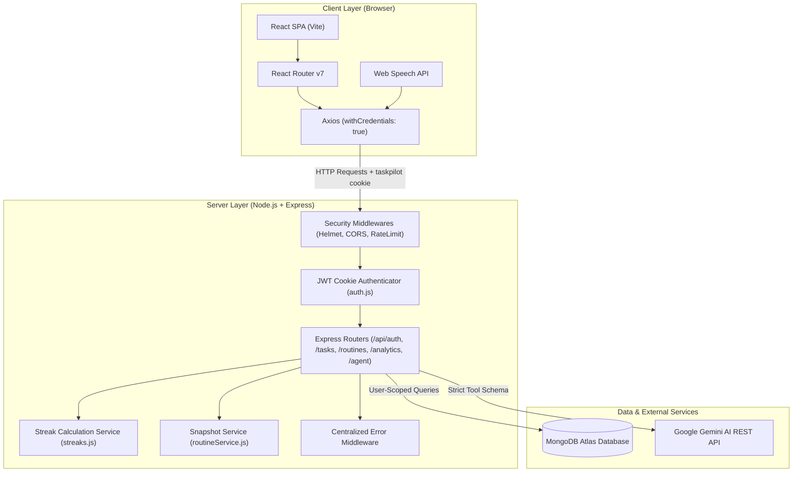
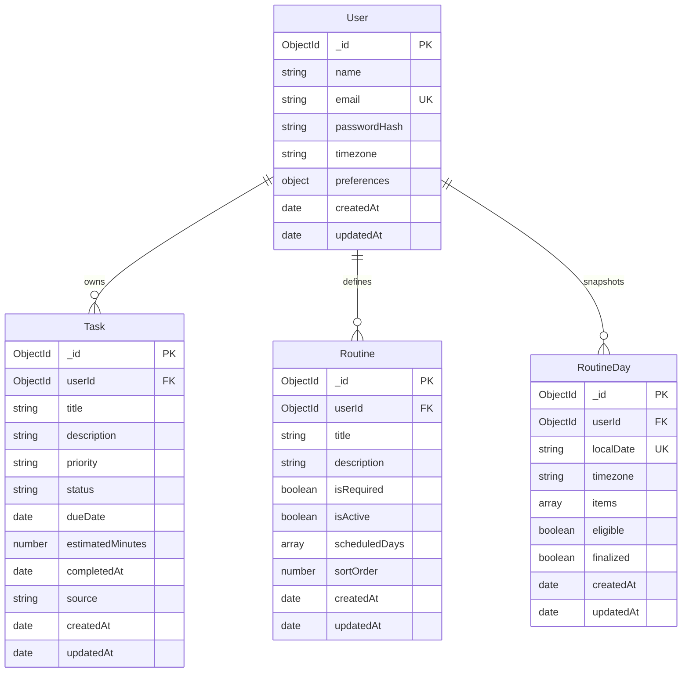
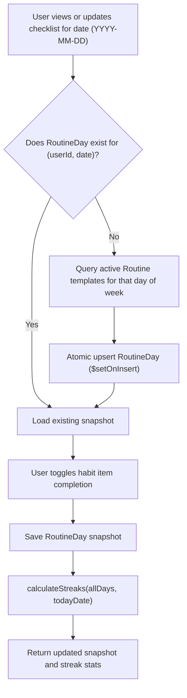
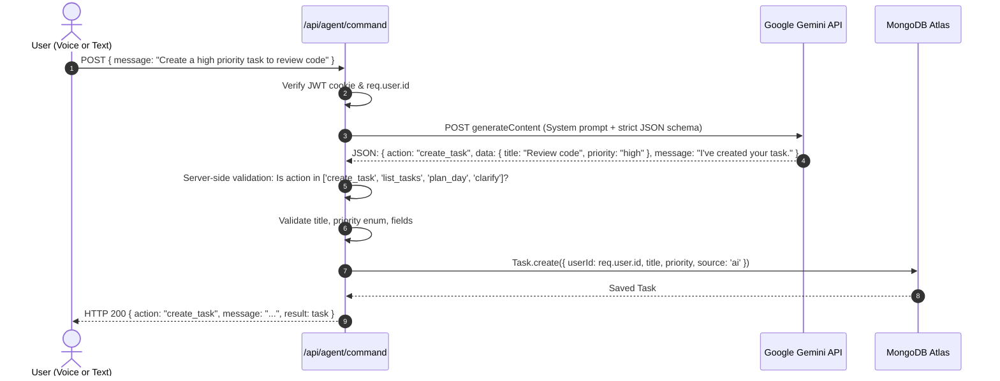
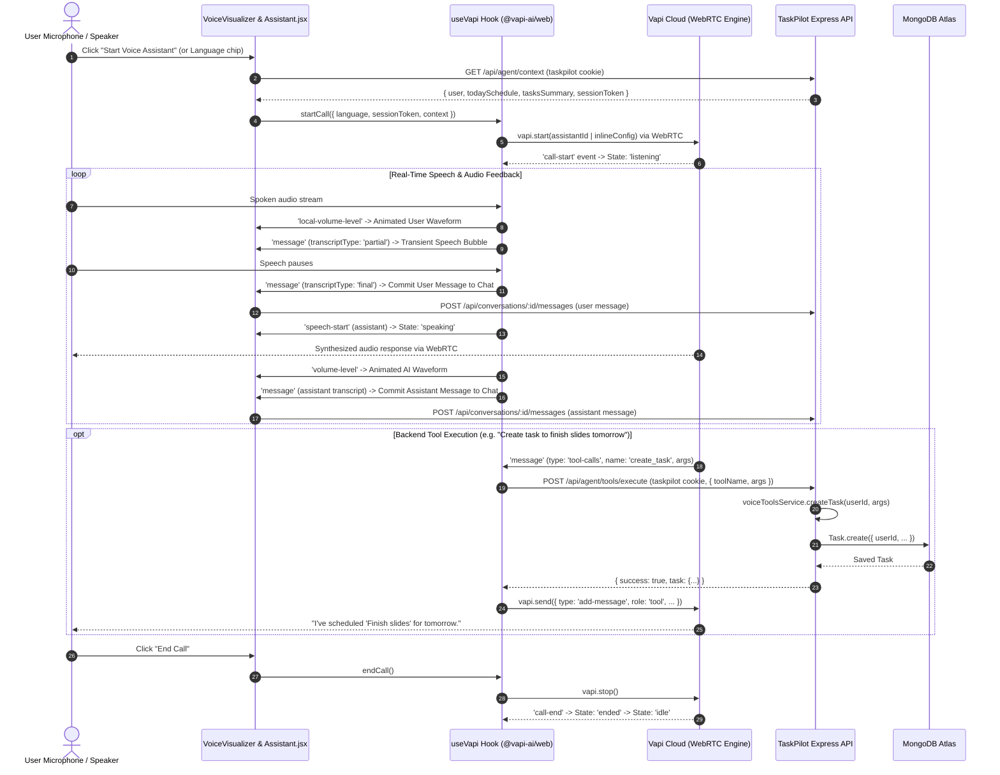

# TaskPilot AI — Architecture Documentation

This document provides an in-depth breakdown of the architecture, security model, and data patterns implemented in **TaskPilot AI**.

---

## 1. System Overview

TaskPilot AI is designed as a modular, decoupled full-stack application:
- **Frontend:** Single Page Application (SPA) built with React 18 and Vite, styled with custom Vanilla CSS for zero-runtime performance and full design control.
- **Backend:** REST API server built with Node.js and Express (ES Modules), with Helmet for HTTP headers, CORS protection, rate limiting, and centralized error handling.
- **Database:** MongoDB Atlas via Mongoose with compound indexes and schema validations.
- **External AI:** Google Gemini 1.5 / 2.5 / 3.5 API via structured JSON outputs and server-side action validation.



---

## 2. Authentication & Session Security Flow

TaskPilot uses **signed, HTTP-only JWT cookies** to provide secure, persistent sessions while protecting against Cross-Site Scripting (XSS) and Cross-Site Request Forgery (CSRF).

```mermaid
sequenceDiagram
    autonumber
    actor User as User Browser
    participant API as Express API
    participant DB as MongoDB Atlas

    Note over User,API: Sign In / Registration Flow
    User->>API: POST /api/auth/login (email, password)
    API->>DB: User.findOne({ email: normalizedEmail })
    DB-->>API: User Record with passwordHash
    API->>API: bcrypt.compare(password, passwordHash)
    API->>API: jwt.sign({ id: user._id }, JWT_SECRET, { expiresIn: '7d' })
    API-->>User: Set-Cookie: taskpilot=<token>; HttpOnly; SameSite=Lax; MaxAge=7d<br/>HTTP 200 { user: publicProfile }

    Note over User,API: Authenticated Request Flow
    User->>API: GET /api/tasks (Cookie: taskpilot=<token>)
    API->>API: auth middleware verifies JWT signature
    API->>DB: Task.find({ userId: req.user.id })
    DB-->>API: User-scoped task records
    API-->>User: HTTP 200 { tasks: [...] }

    Note over User,API: Logout Flow
    User->>API: POST /api/auth/logout
    API-->>User: Set-Cookie: taskpilot=; MaxAge=0; HttpOnly
```

### Security Measures:
- **`httpOnly: true`**: Prevents client-side scripts from reading the JWT via `document.cookie`, neutralizing XSS token theft.
- **`sameSite: 'lax'`**: Protects against cross-site request forgery for state-changing cross-origin requests.
- **`secure: process.env.NODE_ENV === 'production'`**: Ensures cookies are only transmitted over HTTPS in production.
- **Password Hashing**: Uses `bcryptjs` with salt round cost factor 12.
- **Rate Limiting**: `express-rate-limit` limits authentication attempts to 30 requests per 15-minute window per IP.

---

## 3. Database Schema & Indexing Strategy

TaskPilot defines four core collections in MongoDB:



### Indexing Rationale:
1. **`User.email`**: Unique index enforces account uniqueness and accelerates login lookups.
2. **`Task.userId + dueDate + status`**: Compound index optimizes the most frequent queries:
   - Filtering a user's tasks by due date (today's view or calendar month matrix).
   - Filtering open tasks (`status !== 'completed'`) for daily planning.
3. **`Routine.userId`**: Scopes habit templates to individual users.
4. **`RoutineDay.userId + localDate`**: Unique compound index guarantees that each user has exactly one checklist snapshot per calendar date, preventing duplicate records.

---

## 4. Routine Snapshotting & Streak Architecture

A common flaw in habit trackers is mutating historical completion when a routine template is changed. TaskPilot solves this with the **Date Snapshot Pattern**:



### Streak Computation Rules (`server/services/streaks.js`):
1. **Routine Checklists Only:** Normal tasks never enter streak calculations.
2. **Eligibility:** A date counts if and only if `eligible === true`, has at least one required routine item, and **all** required items are marked completed.
3. **Optional Items:** `isRequired === false` items never prevent a day from earning a streak.
4. **Pending Today:** If today is not completed yet, the current streak counts consecutive successful days backwards starting from yesterday. Today does not break the streak while the user still has time to complete it.
5. **Midday UTC Arithmetic:** Stepping back one day is computed with midday UTC (`12:00:00Z`) to ensure that daylight savings time adjustments never cause unintended calendar date shifts.

---

## 5. AI Assistant Architecture: Allowlisted Action Pattern

TaskPilot uses the **Allowlisted Action Pattern** for AI commands. The LLM is never given direct access to MongoDB or arbitrary code execution:



### Safety Guarantees:
- **Tenant Scoping:** The `userId` is injected from the authenticated session, never accepted from the LLM.
- **Restricted Operations:** Destructive actions (such as deletion or updating routine configurations) cannot be performed by the AI assistant.
- **Timeout Protection:** AI requests use a 25-second `AbortSignal.timeout` to prevent server thread blocking.
- **Graceful Degradation:** If `GEMINI_API_KEY` is not configured, the API returns HTTP 503 with a clear message, leaving all other workspace features fully operational.

---

## 6. Vapi Multilingual Voice Assistant Architecture

TaskPilot integrates the official `@vapi-ai/web` SDK to provide natural, real-time voice conversations with bi-directional audio streaming over WebRTC.



### Voice Architecture Highlights:

1. **Client-Managed WebRTC Session (`vapiClient.js` & `useVapi.js`):**
   - Implements a singleton Vapi client ensuring zero duplicate audio sessions.
   - Cleans up all audio contexts and SDK event listeners when components unmount.
   - Tracks 8 explicit visual states: `idle`, `connecting`, `listening`, `user_speaking`, `processing`, `assistant_speaking`, `error`, `ended`.

2. **Multilingual Speech & Model Matrix:**
   - Supports **English (`en`)**, **Kannada (`kn`)**, and **Hindi (`hi`)**.
   - Dynamically configures the Deepgram transcriber (`language: 'kn' | 'hi' | 'en'`) and Cartesia voice (`model: 'sonic-multilingual'`).
   - Injects localized first-turn greetings and instructions directly into the session configuration.

3. **Dual-Channel Secure Tool Execution:**
   - **Primary (Client-Side Dispatch):** When Vapi triggers a client-side tool call event, the browser executes `POST /api/agent/tools/execute` carrying the user's native HTTP-only cookie.
   - **Secondary (Server Webhook):** External Vapi webhooks call `POST /api/agent/vapi-webhook` using a signed, 30-minute JWT session token generated by `/api/agent/context`, avoiding cookie loss across server-to-server calls.
   - Both paths delegate to `server/services/voiceToolsService.js` where all queries and writes are strictly scoped to `userId: req.user.id`.

4. **Conversation Persistence (`Conversation.js` & `conversationRoutes.js`):**
   - Each conversation stores normalized messages (`id`, `role`, `content`, `mode`, `language`, `timestamp`).
   - Server-side deduplication ignores duplicate message IDs emitted during transcript finalization.
   - Compound index `{ userId: 1, lastActivityAt: -1 }` guarantees instant loading of recent sessions in the history sidebar.

